# P5 Connections and Credential Security

**Status:** current guide for P5 Command Lab 0.5.1

## Purpose and capability boundary

This guide shows what crosses the machine and network boundaries when an
operator uses P5's `nsdchat` CLI or REST API. It also explains why P5 Command
Lab saves passwords in macOS Keychain instead of profiles, JSON exports, shell
scripts, or command history.

This guide is based on Archiware P5 8.0.6, the latest release available when
it was written. The diagrams use fictional hosts and placeholders only. Archiware's
[CLI manual](https://support.archiware.com/downloads/cli.pdf) and
[P5 REST API reference](https://www.archiware.com/blog/redoc/p5_rest_api/awp5api.html)
remain authoritative for the installed P5 version.

## The connection paths



[Editable Mermaid source](Diagrams/p5-connection-paths.mmd)

### 1. Local direct `nsdchat`

```text
/usr/local/aw/bin/nsdchat -c srvinfo lexxvers
```

The Terminal or P5 Command Lab launches the `nsdchat` binary installed with P5.
With no `-s` connection argument, it addresses the default P5 application
server on the same Mac. No REST request or off-Mac network path is involved.

### 2. Local `nsdchat` via `awfile`

```text
/usr/local/aw/bin/nsdchat -s 'awfile://usr/local/aw:lexxsrv' -c srvinfo lexxvers
```

The CLI manual describes `awfile` as a named-pipe connection available only
when `nsdchat` and P5 run on the same computer. This mode is local even though
the operator explicitly supplies a server identifier.

### 3. Remote `nsdchat` via `awsock`

```text
/usr/local/aw/bin/nsdchat -s 'awsock:/<username>:<password>@p5.example.invalid:9001' -c srvinfo lexxvers
```

Here, `nsdchat` still runs on the operator's Mac, but it connects to the remote
P5 CLI service through a TCP socket. The official CLI syntax places the user
name and password in the `awsock` connection string. The CLI manual documents
TCP sockets but does not state that this channel uses TLS. Consequently, do not
treat remote `awsock` as encrypted merely because it is authenticated. Keep it
on a trusted private network or protect the route with a properly configured
VPN or other secure tunnel.

P5 Command Lab redacts the password in normal previews and transcripts and
passes arguments directly to `Process` instead of invoking a shell. The actual
remote `nsdchat` process must still receive the credential-bearing `awsock`
argument, so a user or administrator able to inspect that process may see it
while the command is running.

### 4. REST with `curl` or P5 Command Lab

REST does not require a local P5 installation or `nsdchat`. Terminal can use
the macOS-provided `curl`; P5 Command Lab uses Apple's networking APIs.

```text
curl --user '<username>' \
  'https://p5.example.invalid:8000/rest/v1/general/srvinfo'
```

With no password after the user name, `curl` prompts for it instead of putting
it in the process arguments. This is still a shape-only example. Do not put a
real password in a shared script, screenshot, issue, or recorded demonstration.
The P5 REST reference specifies HTTP Basic authentication and documents both
`http://` and `https://` endpoints.

- **HTTP:** [RFC 7617](https://www.rfc-editor.org/rfc/rfc7617) defines Basic
  authentication as Base64-encoded credentials and says it is not secure
  without an external secure system such as TLS. Anyone able to observe or
  alter the network path may obtain the credentials, request, or response. Use
  plain HTTP only for a deliberately bounded local lab or an isolated, trusted
  management path.
- **HTTPS:** TLS encrypts the credentials and payload in transit and verifies
  the server's identity when certificate validation succeeds. Encryption is
  not enough if the operator accepts an unverified or substituted certificate.

## Choosing a transport


[Editable Mermaid source](Diagrams/p5-transport-choice.mmd)

| Path | Software required on the operator Mac | Network transport | Credential concern | Recommended use |
| --- | --- | --- | --- | --- |
| Local direct `nsdchat` | P5 installation containing `nsdchat` | None | No remote connection string | Same-Mac administration and demonstrations |
| Local `awfile` | P5 installation containing `nsdchat` | Same-Mac named pipe | Optional credentials can be included | Explicit same-Mac P5 service selection |
| Remote `awsock` | A local `nsdchat` binary | TCP socket | Password is in the connection argument; CLI manual does not document TLS | Trusted/private network or secure tunnel |
| REST over HTTP | `curl` or an HTTP client | Plain HTTP | Basic credentials and payload are not encrypted | Bounded local lab or isolated management path only |
| REST over HTTPS | `curl` or an HTTPS client | TLS | Verify the server certificate; protect stored credentials | Preferred REST path across a network |

## Why P5 Command Lab uses Keychain



[Editable Mermaid source](Diagrams/p5-credential-lifecycle.mmd)

P5 Command Lab stores each saved password as a macOS Keychain generic-password
item keyed to the profile's stable identifier. The profile itself contains
connection settings, not the password. Portable `P5Servers.json` exports also
exclude passwords and Keychain references.

This design provides several practical protections:

- a password is not left as readable text in app preferences, JSON, or a shell
  script;
- a normal command preview, transcript, or server-list export does not contain
  the saved password;
- macOS mediates Keychain access and may ask the operator to authorize a newly
  signed build; and
- deleting a profile also deletes its associated Keychain item.

Keychain is a safer storage boundary, not a promise that a live, compromised
user account is harmless. P5 Command Lab must load a password into memory for a
live request. REST sends it in an Authorization header, protected in transit
only when HTTPS is used. Remote `awsock` additionally exposes it transiently as
a process argument required by `nsdchat`.

## Passwords in Terminal and scripts

Avoid placing a real password directly in a command line such as
`curl --user username:password ...` or in an `awsock` string saved in a script.
Depending on the shell, invocation, and system permissions, secrets may remain
in shell history, the script file, copied terminal output, screen recordings,
or process inspection while the command runs.

For one-off troubleshooting:

1. Prefer P5 Command Lab or another client that retrieves the password from a
   protected credential store.
2. If `curl` must be used, consult the locally installed `curl` documentation
   for an input method appropriate to the site's security policy; do not invent
   a reusable plaintext credentials file as a shortcut.
3. Keep verbose traces, copied commands, screenshots, and exported responses
   out of tickets and chat until they have been reviewed and redacted.
4. Use a dedicated P5 account with only the privileges required for the task,
   and rotate it if exposure is suspected.

Do not assume that an environment variable makes a literal secret safe. It can
avoid a history entry in some workflows, but it may still leak through a parent
process, debugging output, crash reports, or a carelessly saved shell profile.

## HTTPS certificate trust and pinning

P5 Command Lab applies one of two HTTPS trust models:

- **macOS trust:** the normal system trust store validates the server chain and
  host name. This is preferred when P5 has a certificate issued by a trusted
  internal or public certificate authority.
- **Reviewed fingerprint:** for a self-signed P5 certificate, the operator can
  compare its SHA-256 fingerprint through a separate trusted channel and pin
  that exact certificate to the profile's host and REST port.

If a pinned certificate changes, Command Lab refuses the request until the
replacement has been reviewed. It never silently falls back from HTTPS to
HTTP. A legitimate P5 upgrade, reinstall, or certificate renewal can change a
fingerprint, but that expected event should still be verified out of band.

## What each observer may learn

| Observer or artifact | Local direct / `awfile` | Remote `awsock` | REST HTTP | REST HTTPS |
| --- | --- | --- | --- | --- |
| Shell history or saved script | Command and arguments if typed or saved | May include credentials | May include credentials and URL | May include credentials and URL |
| Same-user/admin process inspection | Local arguments | Credential-bearing connection argument | `curl` arguments may expose credentials | `curl` arguments may expose credentials |
| Network observer | No network hop | TCP traffic; do not assume encryption | Credentials, request, and response are exposed | Sees endpoints and traffic metadata, not TLS-protected contents |
| P5 Command Lab profile/export | No password | No password | No password | No password; reviewed fingerprint may stay in the local profile but is not exported |
| P5 Command Lab normal preview/transcript | Password redacted | Password redacted | Password redacted | Password redacted |

## Demonstration checklist

- Use a fictional host such as `p5.example.invalid` and placeholder credentials.
- First show local direct `nsdchat` and point out that P5 and `nsdchat` are on
  the same Mac.
- Then show remote `awsock` and identify both security boundaries: the process
  argument on the operator Mac and the TCP network path.
- Compare identical REST requests over HTTP and HTTPS without entering a real
  password. Explain that Basic authentication does not become encryption until
  TLS protects it.
- Show **Check Certificate…** and explain macOS trust versus a separately
  verified fingerprint.
- Show that **Export Servers JSON…** contains connection metadata but no
  password, certificate fingerprint, demo profile, or local tool path.
- Keep demo recordings and screenshots free of real hostnames, user names,
  paths, volume labels, job IDs, and server responses.

## Current boundaries and planned improvements

Current Command Lab behavior includes Keychain storage, password-redacted
previews, endpoint-bound certificate pins, refusal of changed pins, no HTTPS to
HTTP downgrade, and password-free server-list exports. It does not create a
VPN, configure P5 TLS, conceal the required remote `awsock` argument from local
process inspection, or prove that a remote network path is trustworthy.

Useful future illustrations include a packet-capture teaching lab using only
fictional credentials, a certificate-renewal runbook, and a least-privilege P5
account matrix. Those should remain documentation exercises until they have
been checked against the installed P5 version and the site's own security
policy.

## Related documentation

- [P5 Command Lab User Guide](USER_GUIDE.md)
- [Official P5 CLI/nsdchat manual](https://support.archiware.com/downloads/cli.pdf)
- [Official Archiware P5 REST API](https://www.archiware.com/blog/redoc/p5_rest_api/awp5api.html)
- [Archiware Manuals & Guides](https://www.archiware.com/manuals/)
- [RFC 7617: The Basic HTTP Authentication Scheme](https://www.rfc-editor.org/rfc/rfc7617)
